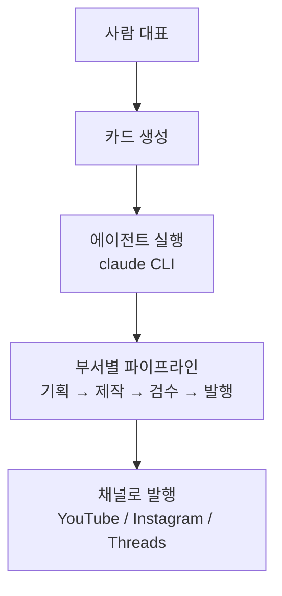

## 한 줄 결론

Agentic_office는 콘텐츠 제작·업무 자동화를 담당하는 수십 개의 AI 에이전트를
"부서"로 묶어 1인 체제로 운영하는 로컬 가상 사무실이다.

## 비유

실제 회사라면 기획팀·디자인팀·발행팀 담당자를 각각 채용해야 하지만, 여기서는
그 역할마다 AI 에이전트 1명씩을 "직원"으로 두고, 카드(작업) 하나를 맡기면 그
직원이 끝까지 처리한다. 사람은 대표 1명이고, 나머지는 전부 AI 직원이다.

## 개념 표

| 용어 | 비유 | 설명 |
|---|---|---|
| 카드 | 업무 지시서 | 실행할 작업 단위, claude CLI 서브프로세스로 처리 |
| 에이전트 | 직원 | `.claude/agents/*.md`로 정의된 역할·권한 |
| 부서 | 팀 | 카드뉴스팀·영상팀·강의팀 등 역할별로 묶은 단위 |
| 파이프라인 | 업무 흐름 | 기획→제작→검수→발행처럼 단계별로 이어지는 작업 |

## 구조 다이어그램



## 동작 원리

로컬 Python 서버(`server/app.py`)가 사무실 화면과 칸반을 제공하고, 카드를 실행하면
`claude` CLI를 서브프로세스로 띄워 해당 에이전트 역할(frontmatter)로 작업을 처리한다.
결과는 다시 서버가 폴링해 화면에 보여주고, 기획→제작→검수→발행처럼 여러 단계가
필요한 콘텐츠는 단계마다 다른 에이전트가 이어받아 처리한다 — 한 명이 전부 하지
않고 발행 권한을 제작 단계에 몰아주지 않는 게 원칙이다.

## 최소 예시

```console
$ python3 server/app.py  # → http://localhost:8760 에서 사무실 화면
```
{: .nolineno }

카드 하나를 "카드뉴스 만들어줘"로 등록하면 `card-news-planner`(기획) →
`card-news-writer`(카피) → `card-news-designer`(비주얼) → `card-news-reviewer`(검수) →
`card-news-publisher`(발행) 순으로 자동 이어진다.

## 요약

| 항목 | 내용 |
|---|---|
| 목적 | 1인 체제로 콘텐츠 제작·업무 자동화 확장, 궁극적으로 콘텐츠 수익화 |
| 구조 | 부서별 AI 에이전트 + 카드(작업) 기반 실행 |
| 원칙 | 기획·제작·검수·발행 단계 분리, 발행 권한은 항상 별도 단계 |
